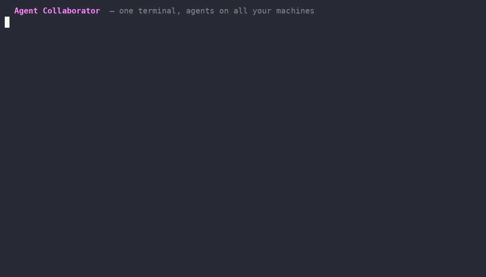

# Agent Collaborator

**Keep your agents working across your machines, without stopping when one AI subscription runs out: auto-route Claude → Codex → others.**

[](https://github.com/TheAdaply/agent-collaborator/actions/workflows/ci.yml)
[](LICENSE)
[](go.mod)

## Demo



## What it is

Agent Collaborator is one small binary per machine. It connects AI coding agents over your own
Tailscale network and routes tasks to the first configured engine that is available and has usage left.
No central service or additional account: identity comes from your tailnet.

This is early v0.1 software. Continuity depends on another engine being installed, signed in, and
available; it cannot promise unlimited credit or uninterrupted execution.

## Quick start

For installation without Go, choose the archive for your OS (Linux or macOS) and
architecture (amd64 or arm64) from the [Releases page](https://github.com/TheAdaply/agent-collaborator/releases)
when a release is available. Verify it against the release checksums, extract it, and place
`agent-collaborator` in a directory on PATH.

Alternatively, with Go 1.27.3 or newer:

```sh
go install github.com/TheAdaply/agent-collaborator/cmd/agent-collaborator@latest
agent-collaborator run "summarize what changed in this repo this week"
```

Make sure your Go bin directory is on PATH. Optionally add this to your shell configuration:

```sh
alias ac='agent-collaborator'
```

`ac` may collide with GNU accounting on some Linux systems, so the alias is optional.
The commands below use the full binary name. Help and command examples adapt to the invoked executable
name, including a binary or symlink named `ac` (shell aliases expand before execution).

## Connect your machines

On each machine, with Tailscale access and your chosen engine CLIs installed and signed in:

```sh
agent-collaborator init                 # ~/.config/agent-collaborator/config.toml
agent-collaborator service install      # run at login; first tsnet start prints a login link
agent-collaborator setup claude         # also: codex, gemini
```

Use `agent-collaborator up` to run in the foreground instead. Service generation supports Linux
(systemd user services) and macOS (launchd). Setup registers the MCP server under the stable key
`agent-collaborator`.

```sh
agent-collaborator doctor              # read-only setup checks; FAIL exits non-zero
agent-collaborator who
agent-collaborator ask desktop "run the GPU benchmarks"
agent-collaborator ask desktop/conductor "status?"
agent-collaborator send laptop/claude-api "FYI: schema changed, see docs/schema.md"
```

Agents receive `who`, `send`, `check_inbox`, `reply`, and `engines` tools. An address is a machine
(its router runs the task) or `machine/session` (a live agent).

## How it works

```text
 laptop                             desktop
 ┌──────────────────────────┐       ┌─────────────────────────────────┐
 │ Claude Code ── MCP ─┐    │       │ Agent Collaborator daemon       │
 │ CLI ────────────────┼────┼──────▶│  Tailscale WhoIs → trust check   │
 │ daemon ◀───────────┘    │tailnet│  ├─ session → tmux or inbox      │
 └──────────────────────────┘       │  └─ machine → credit-aware router│
                                    │       Claude → Codex → Gemini  │
                                    └─────────────────────────────────┘
```

Live sessions receive messages through a tmux pane or an inbox read with `check_inbox`. Asks accept
one reply, from the machine asked. Messages to offline machines queue for up to 24 hours.
Inbox, queue, engine cooldowns, and the append-only `audit.jsonl` live under
`~/.local/state/agent-collaborator`. Use `agent-collaborator log` to inspect activity.

## Engines

Built-in TOML adapters cover [Claude Code](internal/engine/builtin/claude.toml),
[Codex](internal/engine/builtin/codex.toml), and [Gemini CLI](internal/engine/builtin/gemini.toml).
The credit-aware router tracks exhaustion responses and cooldowns. It moves on for engines that are
missing, not signed in, or out of usage. A task failure is reported rather than retried on another engine.
When handing off, it tells the next engine what the previous attempt may already have changed.

```sh
agent-collaborator engines
agent-collaborator engines --reset codex
```

Add a TOML adapter under `~/.config/agent-collaborator/engines/` and list its name in the config:

```toml
name = "opencode"
detect = "opencode"
run = ["opencode", "run", "{prompt}"]
exhausted = ['(?i)usage limit', '\b429\b']
cooldown = "1h"
```

See [the adapter reference](docs/engines.md) and [examples](examples/engines).

## The fleet dashboard

Run `agent-collaborator fleet` for machine inventory, usable engines, live sessions, and recent local
audit entries. Open `http://<tailnet-machine>:7433/fleet` (or `/`, using your configured port) for the
mobile-friendly dashboard. It refreshes every 10 seconds and shows the last 30 local audit entries.

The dashboard is owner-only: the browser must be on Tailscale and identified as the daemon's owner.
Team members and unidentified callers receive 403. It uses the existing tailnet listener with no
external assets. Session working directories are omitted. Activity is local to the viewed machine;
peer inventory uses the existing `who` fan-out. Both views show only machines that
answer the Agent Collaborator inventory request; bare tailnet devices and unreachable
peers are omitted, rather than inferred to be offline agents. Conversations remain in Claude Remote Control.

## Security

Read [the security model](docs/security.md) before granting access. Tailscale WhoIs identifies peers;
your own login is the owner, explicitly listed team logins get shared sessions and read-only engine
modes, and everyone else is refused. The local control socket is mode 0600 and acts with owner authority.

Peer messages are framed as requests, with hop limits, rate limits, and no forwarding. These controls
do not make model prompt injection impossible. Built-in owner engine commands disable permission
prompts for unattended work; override their adapters if you need stricter execution.

For vulnerabilities, use a private GitHub security advisory as described in [docs/security.md](docs/security.md#reporting-a-vulnerability).

## Config

`agent-collaborator init` writes a commented TOML config with network mode, engine order, work directory,
timeouts, and trust settings. Defaults are `~/.config/agent-collaborator` and
`~/.local/state/agent-collaborator`; `XDG_CONFIG_HOME` and `XDG_STATE_HOME` are respected.

`AC_HOME=/some/dir` places config and state in one tree, useful for isolated local nodes.
`AC_SESSION` selects a session name. Tasks receive `AC_TASK` and `AC_HOPS` for correlation and loop
tracking. `network = "local"` is for loopback development and trusts local callers as owner.

## Status/roadmap

Early v0.1, targeting Linux and macOS. The suite covers routing with fake engines, trust checks,
local two-daemon messaging, inbox/reply delivery, tmux delivery, offline queueing, MCP tools, and fleet
visibility. Prior manual router testing included Claude Code. Real tailnet operation across two
machines remains the next milestone; it has not yet been validated by these local tests.

See [ROADMAP.md](ROADMAP.md) for planned work.

Next: validate cross-machine tailnet operation and harden adapters and unattended workflows from
real usage. The public module must be published before the `@latest` install command is available.

## Contributing

```sh
make            # builds bin/agent-collaborator
make test       # format/vet, unit tests, local e2e; fake engines use no AI credit
```

Go and tmux are needed for the full suite. See [CONTRIBUTING.md](CONTRIBUTING.md) for pull requests.

## License

[Apache-2.0](LICENSE).
